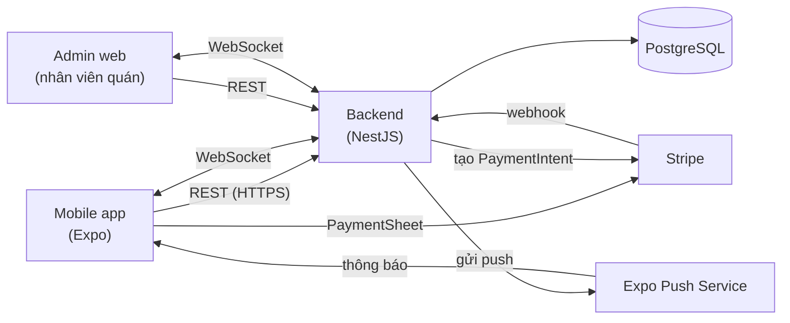
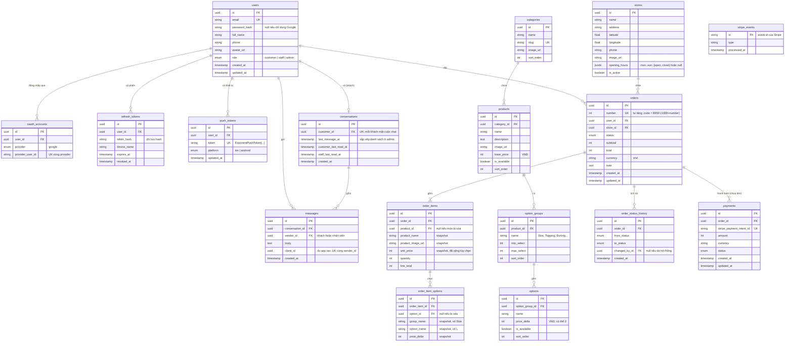
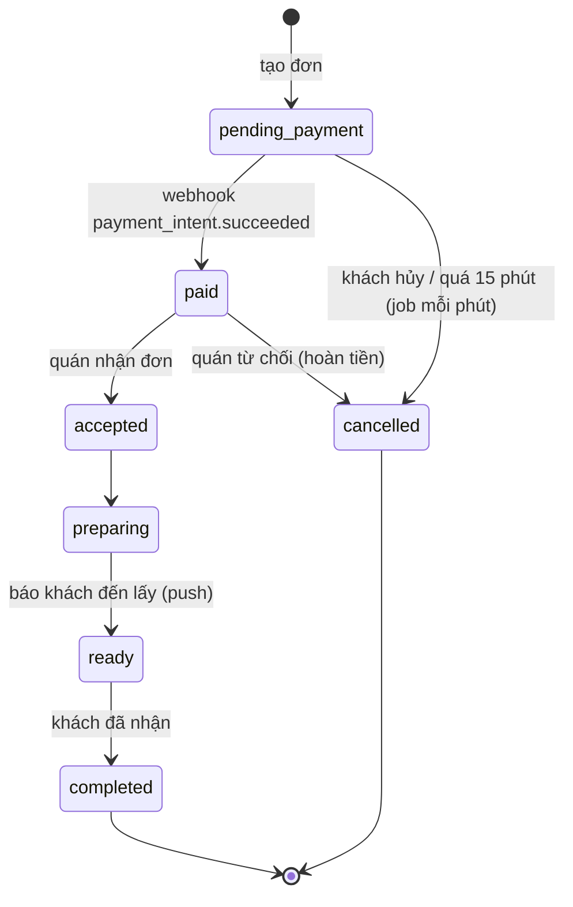
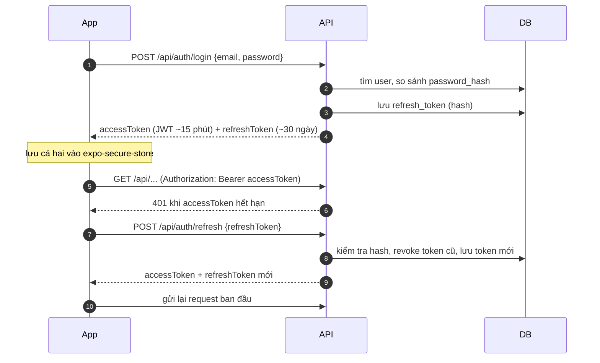
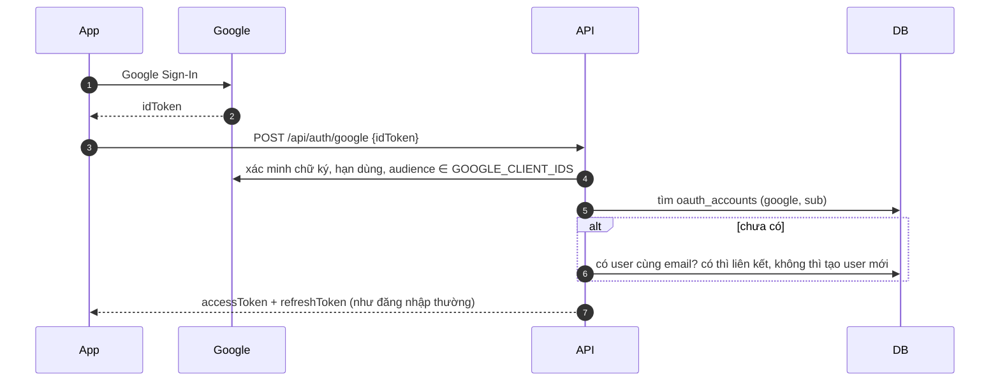
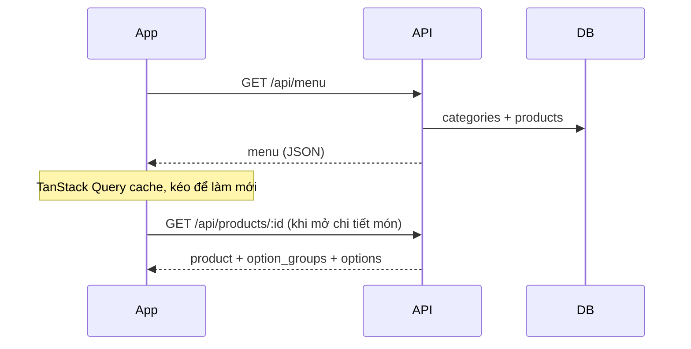
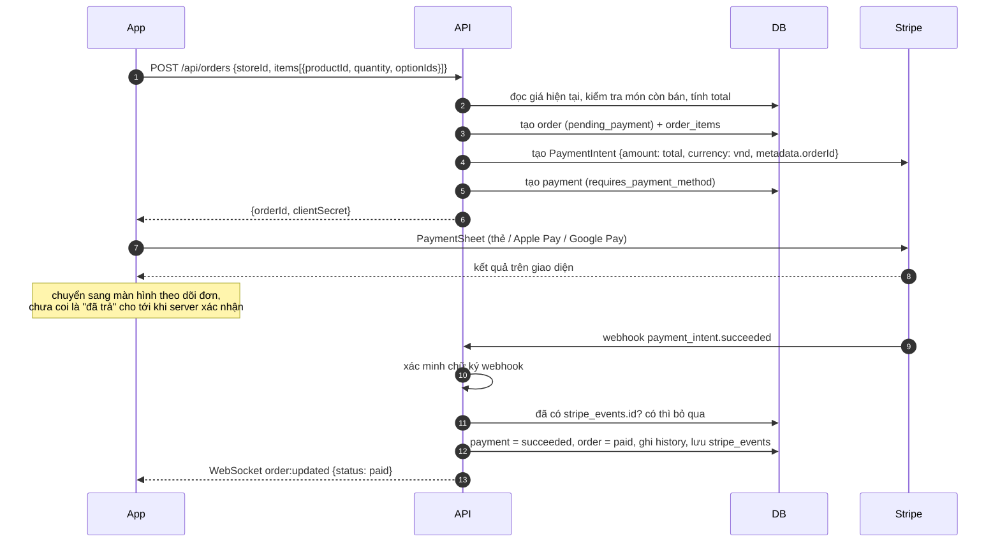
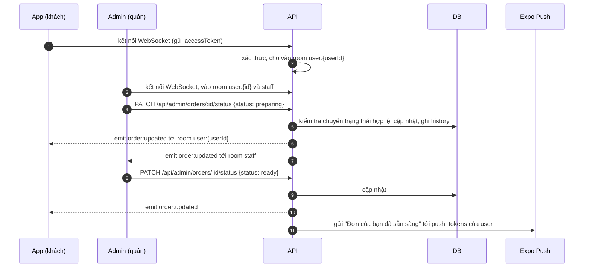
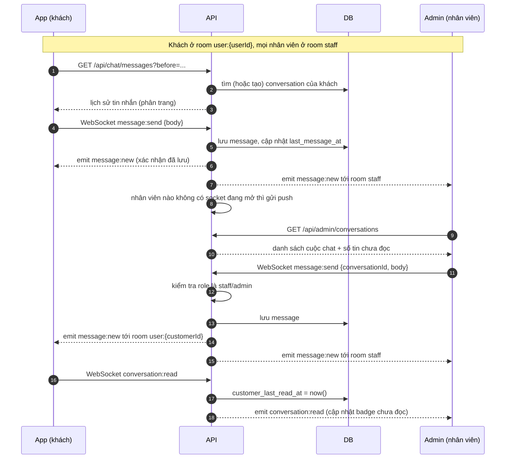

# Data model và data flow

Thiết kế dữ liệu và luồng xử lý. Code thật nằm ở `backend/src/**/entities/*.entity.ts`; khi đổi entity thì cập nhật file này.

**Trạng thái:** đã làm tất cả, **trừ** Stripe (bảng `payments`, `stripe_events`, webhook).
Những chỗ đó trong code được đánh dấu `TODO(stripe)`.

Sơ đồ viết bằng [Mermaid](https://mermaid.js.org/). GitHub hiển thị sẵn; trong VS Code cài extension
"Markdown Preview Mermaid Support" rồi mở preview (`Cmd + Shift + V`).

## Tổng quan hệ thống



**Nguyên tắc chung**

- **Database là nguồn sự thật duy nhất.** WebSocket chỉ để báo "có thay đổi"; app luôn có thể gọi REST để lấy lại trạng thái đúng.
- **Không tin giá từ app.** App gửi lên *món + số lượng + tùy chọn*, server tự tính tiền từ database.
- **Thanh toán chỉ được xác nhận qua webhook của Stripe**, không dựa vào việc app báo "đã trả xong".
- **Tiền lưu bằng số nguyên** theo đơn vị nhỏ nhất của tiền tệ. VND không có số lẻ (Stripe coi là zero-decimal),
  nên `45000` nghĩa là 45.000 ₫. Không dùng kiểu float cho tiền.

## Data model



### Giải thích các quyết định

| Quyết định | Lý do |
|---|---|
| **Giỏ hàng không lưu ở server** | Giỏ hàng nằm trong app (Zustand + MMKV). Server chỉ nhận dữ liệu lúc tạo đơn, nên bớt được bảng và API. |
| **Snapshot tên và giá trong `order_items`, `order_item_options`** | Quán đổi giá hoặc xóa món thì đơn cũ vẫn phải hiển thị đúng như lúc khách mua. |
| **`refresh_tokens` chỉ lưu hash** | Lộ database cũng không dùng được token. Mỗi thiết bị một dòng, nên "đăng xuất thiết bị khác" chỉ cần đặt `revoked_at`. |
| **`oauth_accounts` tách khỏi `users`** | Một người có thể vừa đăng nhập bằng email vừa bằng Apple/Google. |
| **`payments` tách khỏi `orders`** | Một đơn có thể thanh toán lỗi rồi thử lại, tức là nhiều PaymentIntent cho một đơn. |
| **`stripe_events`** | Stripe có thể gửi cùng một webhook nhiều lần. Lưu `event.id` đã xử lý để không xử lý trùng. |
| **`push_tokens`** | Push notification là cách duy nhất báo cho khách khi **app đã tắt hoặc chạy nền**; lúc đó WebSocket không còn kết nối. Để gửi push, server cần Expo push token của **từng thiết bị** (app lấy bằng `getExpoPushTokenAsync()` rồi gửi lên). Một user có thể đăng nhập nhiều máy nên là bảng riêng, không phải một cột trong `users`. Xóa token khi đăng xuất hoặc khi Expo báo `DeviceNotRegistered`. |
| **Chat giữa khách và quán, không gắn với đơn** | Mỗi khách có **một** `conversations` với phía quán, nhân viên/admin nào cũng trả lời được. Tách `conversations` khỏi `messages` để admin có danh sách cuộc chat (sắp theo `last_message_at`) và đếm tin chưa đọc. |
| **`messages.client_id`** | App tự tạo một UUID cho mỗi tin trước khi gửi. Gửi lại (vì mất mạng, không nhận được ack) với cùng `clientId` sẽ trả về tin đã lưu thay vì tạo tin trùng; app cũng dùng nó để khớp "bong bóng" đang gửi với tin thật. |
| **Đã đọc lưu ở `conversations`, không ở từng tin** | So `created_at` của tin với `customer_last_read_at` / `staff_last_read_at` là biết tin nào chưa đọc, không phải cập nhật từng dòng `messages`. |
| **`order_status_history`** | Hiển thị timeline cho khách và biết nhân viên nào đổi trạng thái. |
| **`orders.number` tự tăng, `code` tính ra** | Postgres tự cấp số không trùng; `code` (BRW-1001) chỉ là cách hiển thị nên không cần lưu. |
| **Xóa món không làm hỏng đơn cũ** | `order_items.product_id` và `order_item_options.option_id` thành null khi món/tùy chọn bị xóa; tên và giá đã được copy sẵn. |
| **Cửa hàng không bao giờ bị xóa** | Đơn hàng tham chiếu tới cửa hàng; muốn ngừng thì đặt `is_active = false`. |

### Trạng thái đơn hàng



Ai được đổi trạng thái nào được định nghĩa ở `backend/src/orders/order-status.ts` (có unit test).
Chưa có Stripe nên dùng tạm `POST /api/dev/orders/:id/mark-paid` để chuyển sang `paid` (tắt khi `NODE_ENV=production`).

Trạng thái thanh toán (`payments.status`, sẽ làm cùng Stripe) bám theo Stripe: `requires_payment_method`, `processing`, `succeeded`, `failed`, `refunded`.

## Data flow

### 1. Đăng nhập và làm mới token



- Refresh token **xoay vòng**: mỗi lần refresh, token cũ bị thu hồi. Nếu một token đã thu hồi bị dùng lại
  (dấu hiệu bị đánh cắp), server **đăng xuất user khỏi mọi thiết bị**. Vì vậy app chỉ được gửi **một** request refresh
  tại một thời điểm; các request khác bị 401 phải chờ lần refresh đó xong.
- Role nằm trong access token, nên khi admin đổi role của ai đó, thay đổi có hiệu lực ở lần refresh kế tiếp (tối đa 15 phút).

### 1b. Đăng nhập bằng Google



Chỉ chấp nhận email Google đã xác minh. Cấu hình: [google-sign-in.md](google-sign-in.md).

### 2. Xem menu



Món hết hàng vẫn được trả về với `isAvailable: false` để app hiển thị "Hết hàng".

### 3. Đặt món và thanh toán Stripe



Secret key của Stripe chỉ nằm trong `backend/.env`. App chỉ có publishable key và `clientSecret` của từng đơn.

### 4. Cập nhật trạng thái đơn theo thời gian thực



Push gửi cho khách khi đơn sang `accepted`, `ready`, `cancelled` (trừ khi chính khách hủy); gửi cho nhân viên khi có đơn `paid`.

Khi app **mất kết nối** hoặc **quay lại từ nền**: kết nối lại WebSocket, rồi gọi `GET /api/orders/:id` để lấy trạng thái
mới nhất, vì có thể đã bỏ lỡ event trong lúc mất kết nối.

### 5. Chat giữa khách và quán



Gửi tin được cả qua WebSocket (`message:send`) lẫn REST (`POST /api/chat/messages`,
`POST /api/admin/conversations/:id/messages`); cả hai đều phát `message:new`. Tin nhắn trả về **mới nhất trước** (hợp với `FlatList inverted`),
trang sau lấy bằng `?before=<id tin cũ nhất đang có>`.

Khách không cần gửi `conversationId`: server tự lấy cuộc chat của user đang đăng nhập,
nên khách không thể đọc hay gửi vào cuộc chat của người khác.

## WebSocket

Code: `backend/src/realtime/` (kết nối, room, kiểu dữ liệu của event) và `backend/src/chat/chat.gateway.ts`.
Kiểu TypeScript của mọi event nằm ở `backend/src/realtime/realtime.events.ts`; app và admin web nên dùng đúng các kiểu này.

### Kết nối

```ts
import { io } from 'socket.io-client';

const socket = io('http://192.168.0.13:3100', {
  transports: ['websocket'],
  // Hàm, để mỗi lần (re)connect đều lấy access token mới nhất.
  auth: (cb) => cb({ token: getAccessToken() }),
});
```

- Không có tiền tố `/api`; đường dẫn mặc định của Socket.IO là `/socket.io`.
- Token sai hoặc thiếu: client nhận `connect_error` với `message` là `Missing access token` hoặc
  `Invalid or expired access token`. Khi đó refresh token rồi `socket.connect()` lại.
- Sau khi kết nối, server tự cho socket vào room `user:{id}`; staff/admin vào thêm room `staff`.
- **Khi access token hết hạn**, server gửi `session:expired` rồi ngắt kết nối. Socket.IO **không tự kết nối lại**
  sau khi server chủ động ngắt, nên app phải refresh token rồi gọi `socket.connect()`.
- **Sau mỗi lần kết nối lại**, gọi REST để lấy lại dữ liệu đang hiển thị (đơn, tin nhắn), vì event phát ra trong lúc
  mất kết nối sẽ không được gửi lại.

### Server gửi cho client

| Event | Gửi tới | Khi nào | Dữ liệu |
|---|---|---|---|
| `order:updated` | chủ đơn + `staff` | Mỗi lần đơn đổi trạng thái (sau khi đã lưu vào DB) | `{ orderId, code, userId, storeId, status, previousStatus, changedAt }` |
| `message:new` | khách của cuộc chat + `staff` | Mỗi tin nhắn mới, gửi qua WebSocket hay REST đều có | `{ conversationId, customerId, message }` |
| `conversation:read` | khách của cuộc chat + `staff` | Khách hoặc nhân viên đánh dấu đã đọc, hoặc nhân viên trả lời | `{ conversationId, customerId, reader: 'customer' \| 'staff', readAt }` |
| `session:expired` | socket đó | Access token hết hạn, ngay trước khi ngắt kết nối | không có |

`message` có dạng `{ id, clientId, conversationId, senderId, sender: { id, fullName, avatarUrl, role }, body, createdAt }`,
giống hệt REST. `sender` không bao giờ chứa email hay số điện thoại. Mọi thời gian là chuỗi ISO 8601.

Người gửi cũng nhận `message:new` cho chính tin của mình (để các thiết bị khác của họ cập nhật).
App bỏ qua event nếu đã có tin cùng `id` hoặc cùng `clientId`.

### Client gửi cho server

Dùng `emitWithAck`; kết quả luôn có dạng `{ ok: true, data }` hoặc `{ ok: false, error: { status, message } }`
với `status` giống HTTP (400 dữ liệu sai, 404 không tìm thấy, 409 xung đột, 429 gửi quá nhanh).

| Event | Ai gửi | Dữ liệu | `data` trả về |
|---|---|---|---|
| `message:send` | khách | `{ body, clientId? }` | tin nhắn đã lưu |
| `message:send` | nhân viên | `{ conversationId, body, clientId? }` | tin nhắn đã lưu |
| `conversation:read` | khách | `{}` | `null` |
| `conversation:read` | nhân viên | `{ conversationId }` | `null` |

```ts
const clientId = crypto.randomUUID();
const res = await socket.timeout(5000).emitWithAck('message:send', { body, clientId });
if (!res.ok) showError(res.error.message);
// Hết 5 giây không có ack: gửi lại với CÙNG clientId (qua socket hoặc POST /api/chat/messages), không tạo tin trùng.
```

Giới hạn mỗi user: 10 `message:send` và 20 `conversation:read` trong 10 giây.

### Push và WebSocket

- Chat: chỉ gửi push cho người **không có socket nào đang mở**; người đang mở app đã nhận qua WebSocket.
- Đơn hàng: luôn gửi push (đơn sẵn sàng là thông báo quan trọng, kể cả khi app vừa chuyển nền).

### Giới hạn hiện tại

Room nằm trong bộ nhớ của tiến trình backend. Chạy nhiều instance backend phía sau load balancer thì cần thêm
Socket.IO Redis adapter, nếu không event chỉ tới được socket kết nối vào cùng instance.

## Endpoint

Danh sách đầy đủ, kèm schema và nút "Try it out": **http://localhost:3100/api/docs** (Swagger, khi chạy backend).

| Nhóm | Endpoint | Quyền |
|---|---|---|
| Health | `GET /api/health` | công khai |
| Auth | `POST /api/auth/register`, `/login`, `/google`, `/refresh`, `/logout` | công khai |
| Tôi | `GET` `PATCH /api/me`, `PUT /api/me/password`, `POST /api/me/avatar`, `POST /api/me/push-tokens`, `DELETE /api/me/push-tokens/:token` | đã đăng nhập |
| Cửa hàng | `GET /api/stores`, `GET /api/stores/:id` | công khai |
| Menu | `GET /api/menu`, `GET /api/products/:id` | công khai |
| Đơn | `POST /api/orders`, `GET /api/orders`, `GET /api/orders/:id`, `POST /api/orders/:id/cancel` | đã đăng nhập |
| Chat | `GET /api/chat`, `GET` `POST /api/chat/messages`, `POST /api/chat/read` | customer |
| Admin: đơn | `GET /api/admin/orders`, `GET /api/admin/orders/:id`, `PATCH /api/admin/orders/:id/status` | staff, admin |
| Admin: chat | `GET /api/admin/conversations`, `GET` `POST /api/admin/conversations/:id/messages`, `POST /api/admin/conversations/:id/read` | staff, admin |
| Admin: menu | `/api/admin/categories`, `/api/admin/products` (+ `/:id/image`, `/:id/option-groups`), `/api/admin/option-groups/:id` (+ `/options`), `/api/admin/options/:id` | admin |
| Admin: cửa hàng | `GET` `POST /api/admin/stores`, `PATCH /api/admin/stores/:id` | admin |
| Admin: user | `GET /api/admin/users`, `GET /api/admin/users/:id`, `PATCH /api/admin/users/:id/role` | admin |
| Dev | `POST /api/dev/orders/:id/mark-paid` (thay webhook Stripe khi chưa có) | chủ đơn hoặc staff |
| Stripe | `POST /api/webhooks/stripe` | **chưa làm** |

WebSocket: xem mục [WebSocket](#websocket) ở trên.
